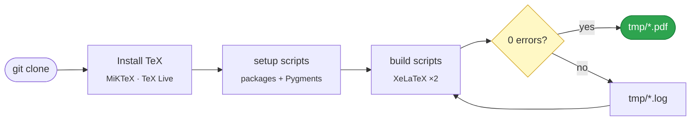

<div align="center">


# CUHKSZ-SAI LaTeX Template

**A bilingual course-work template for CUHK-Shenzhen — typeset, not tinkered with.**

*中文 / English · XeLaTeX · reproducible · one-command setup*

[](LICENSE)
[](#-requirements)
[](#-quick-start)
[](#-quick-start)

[](#-building)
[](#-documents)
[](fonts/LICENSE.txt)
[](https://www.tug.org/texlive/)

[简体中文](README.md) · **English**

</div>

---

## ✨ Highlights

| | |
| --- | --- |
| 🈶 **Bilingual by design** | The Chinese and English documents mirror each other section by section, so one edit propagates predictably. |
| 📐 **Typeset, not nudged** | Every spacing value is explicit — header height, header separation, table rules, line spacing. Nothing relies on a lucky default. |
| 🔁 **Reproducible anywhere** | Fonts are vendored and the toolchain is pinned, so a build on your laptop and a build on a lab machine produce the same PDF. |
| ⚡ **One command** | Clone, run one setup script, build. No manual package hunting, no "which engine was it again?". |
| 🧾 **Clean output** | Both documents build with **0 errors, 0 over/underfull boxes and 0 missing glyphs** — and the build script tells you when that stops being true. |

---

## 📄 Documents

| | Document | Pages | Engine |
| :-: | --- | :-: | :-: |
| 中文 | [`AIE3905_Week7_Milestone_Grading_Standard.tex`](AIE3905_Week7_Milestone_Grading_Standard.tex) | `5` | XeLaTeX |
| EN | [`AIE3905_Week7_Milestone_Grading_Standard_EN.tex`](AIE3905_Week7_Milestone_Grading_Standard_EN.tex) | `6` | XeLaTeX |

> Both are AIE3905 *S03 & S06 — Week 7 Milestone Grading Schema*: a full-width SAI
> letterhead, a formal ruled grading table and a course footer, A4.

---

## 🚀 Quick start

**1 · Install a TeX distribution**

| Platform | Command |
| --- | --- |
| Windows | `winget install --id MiKTeX.MiKTeX` |
| macOS | `brew install --cask mactex-no-gui` |
| Debian / Ubuntu | `sudo apt install texlive-xetex texlive-lang-chinese texlive-latex-extra texlive-fonts-extra` |
| Fedora | `sudo dnf install texlive-scheme-full` |
| Arch | `sudo pacman -S texlive-most texlive-langchinese` |

**2 · Install the packages**

```powershell
git clone <repository-url> && cd CUHKSZ-SAI-LaTeX_Template
.\scripts\setup-miktex.ps1        # Windows
```

```bash
git clone <repository-url> && cd CUHKSZ-SAI-LaTeX_Template
chmod +x scripts/*.sh && ./scripts/setup-texlive.sh    # macOS / Linux
```

**3 · Build**

```powershell
.\scripts\build.ps1 -All          # Windows
```

```bash
./scripts/build.sh --all          # macOS / Linux
```

<div align="center">
<sub>PDFs land in <code>tmp/</code> — <b>no configuration, no questions asked.</b></sub>
</div>

<details>
<summary><b>What the setup scripts actually do</b></summary>

<br>

- Locate `xelatex` and fail loudly with install instructions when it is missing.
- Install all 21 LaTeX packages the documents need, probing `miktex packages info`
  first because MiKTeX treats re-installing an existing package as an error.
- Check `pygmentize` and install Pygments through `pip` when it is absent.
- Verify the vendored fonts, the letterhead and `fonts/LICENSE.txt` are present.

Both scripts are **idempotent** — re-running them reports what is already in place
instead of doing anything destructive.

</details>

---

## 🔧 How it fits together



XeLaTeX runs **twice** so that `hyperref` bookmarks and page labels settle. The build
script then parses the `.log` for errors, over/underfull boxes and missing characters
and exits non-zero when the build is not clean — so a broken build cannot pass silently.

---

## 🧰 Requirements

| Component | Version | Why |
| --- | --- | --- |
| TeX distribution | MiKTeX · TeX Live 2023+ | Provides the engine and packages |
| Engine | **XeLaTeX** | pdfLaTeX cannot build either document — [why?](#why-xelatex) |
| Python + Pygments | any Python 3 | Only `minted` needs it; optional today, required the moment you add a code block |

<a id="why-xelatex"></a>

<details>
<summary><b>Why XeLaTeX and not pdfLaTeX?</b></summary>

<br>

The Chinese document loads `ctex` with `fontset=none` and binds CJK to the vendored
Noto CJK **OpenType** files; the English document uses `fontspec` and `unicode-math`
for Latin Modern. All of that needs a Unicode engine with OpenType support, so the
repository ships a XeLaTeX-only recipe. Changing it to pdfLaTeX will not work.

</details>

---

## 🏗 Building

### VS Code — zero setup

`.vscode/settings.json` is committed with the recipe already wired up.

| Action | Shortcut |
| --- | --- |
| Build | <kbd>Ctrl</kbd>+<kbd>Alt</kbd>+<kbd>B</kbd> |
| View PDF | <kbd>Ctrl</kbd>+<kbd>Alt</kbd>+<kbd>V</kbd> |

- Default recipe: **`xelatex x2 (CJK)`** · output: `tmp/` · SyncTeX forward + inverse search enabled.
- Magic comments are deliberately **off**, so `% !TEX program = xelatex` is documentation rather than a setting.

### Command line

| Windows | macOS / Linux | Effect |
| --- | --- | --- |
| `.\scripts\build.ps1` | `./scripts/build.sh` | Build the Chinese document |
| `.\scripts\build.ps1 -All` | `./scripts/build.sh --all` | Build both |
| `.\scripts\build.ps1 -Clean` | `./scripts/build.sh --clean` | Empty `tmp/` first |
| `.\scripts\build.ps1 -Document <name>` | `./scripts/build.sh <name>` | Build one document by base name |

<details>
<summary><b>Building by hand</b></summary>

<br>

```powershell
xelatex -synctex=1 -shell-escape -interaction=nonstopmode -file-line-error `
        -output-directory=./tmp AIE3905_Week7_Milestone_Grading_Standard.tex
```

Run it **twice**, keep `-output-directory=./tmp` as a single token, and always invoke
it from the repository root — the documents reference `./figs/...` and `./fonts/...`
relative to the build directory.

</details>

---

## 📦 Dependencies

The setup scripts install these distribution package names — not the `\usepackage`
names.

<details open>
<summary><b>21 packages</b></summary>

<br>

| `\usepackage` | MiKTeX / TeX Live package | Provides |
| --- | --- | --- |
| — (engine) | `xetex` | `xelatex.exe` |
| — (engine) | `l3kernel`, `l3packages` | LaTeX3 programming layer |
| `array`, `tabularx` | `latex-tools` (`tools`) | Standard tools bundle |
| — | `latex-fonts` (`fix-cm`) | CM font fixes |
| `bookmark` | `bookmark` | PDF bookmark driver |
| `fontspec` | `fontspec` | OpenType font selection |
| `amsmath` | `amsmath` | Math typesetting |
| `unicode-math` | `unicode-math` | OpenType math |
| `ctex` | `ctex` | CJK support (`xeCJK`, `zhnumber`) |
| `needspace` | `needspace` | Page-break control |
| `geometry` | `geometry` | Page layout |
| `minted` | `minted` | Code listings |
| `xcolor` | `xcolor` | Colour |
| `graphicx` | `graphics` | `\includegraphics` |
| `titling` | `titling` | Title-block control |
| `enumitem` | `enumitem` | List customisation |
| `fancyhdr` | `fancyhdr` | Header / footer |
| `hyperref` | `hyperref` | Hyperlinks, PDF metadata |
| — (fonts) | `lm`, `lm-math` | Latin Modern OpenType |

</details>

> MiKTeX installs missing packages on demand, so a plain build often works before the
> setup script runs. The scripts exist to make it **fast, offline-capable and reproducible**.

---

## 📁 Layout

```
CUHKSZ-SAI-LaTeX_Template/
├── AIE3905_Week7_Milestone_Grading_Standard.tex      Chinese document  (CN)
├── AIE3905_Week7_Milestone_Grading_Standard_EN.tex   English document  (EN)
├── figs/
│   └── cuhk-sai-logo01.png                           full-width letterhead
├── fonts/                                            vendored Noto CJK + OFL text
├── scripts/
│   ├── setup-miktex.ps1  ·  setup-texlive.sh         install packages + Pygments
│   └── build.ps1         ·  build.sh                 build and report
├── .vscode/settings.json                             LaTeX Workshop recipe
├── .gitattributes · .gitignore · LICENSE             housekeeping
└── tmp/                                              build output (ignored)
```

<details>
<summary><b>Why are the fonts vendored?</b></summary>

<br>

So that the documents look identical on every machine — including one with no network
access — instead of silently falling back to whatever CJK font happens to be installed.
The trade-off is that `fonts/` adds roughly 40 MB to the repository.

</details>

---

## 🎨 Customising

| What | Where | Note |
| --- | --- | --- |
| Header logo | `\fancyhead[C]` | Spans the full text width |
| Header / title gap | `headsep=8mm` in `\geometry{...}` | Raise it to push the title down |
| Header height | `headheight=18.5mm` | Must be ≥ the logo height (16.6 mm) or `fancyhdr` warns |
| Chinese fonts | `\setCJKmainfont`, `\setCJKsansfont`, `\newCJKfontfamily\zhhei` | Point at `./fonts/` |
| Latin fonts | `\setmainfont{lmroman10-regular.otf}` | Ships with the TeX distribution |
| Point size | `\documentclass[11pt]{article}` | Top of each file |

> 💡 The two documents mirror each other, so a content change normally belongs in **both**.

---

## 📜 Licence

| Scope | Licence |
| --- | --- |
| Template, scripts, documents | **MIT** © 2026 Zijin CAI — see [`LICENSE`](LICENSE) |
| Noto Serif SC / Noto Sans SC | **SIL OFL 1.1** — a separate licence MIT does not override — see [`fonts/LICENSE.txt`](fonts/LICENSE.txt) |
| CUHK-Shenzhen letterhead | The university's trademark. Included for course material only; **not** covered by MIT |

Fonts upstream: <https://github.com/notofonts/noto-cjk>

---

<div align="center">
<sub>Built for CUHK-Shenzhen · School of Science and Engineering<br>
If this template saved you an afternoon, a ⭐ goes a long way.</sub>
</div>
